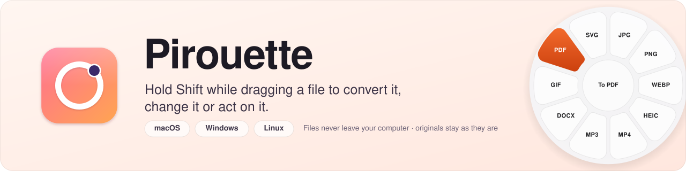
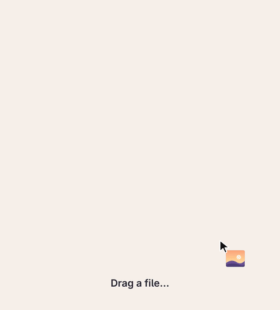
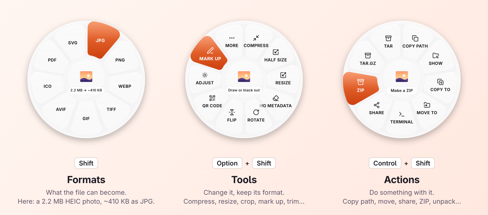

  <picture>
    <source media="(prefers-color-scheme: dark)" srcset="docs/images/banner-dark.svg">
    <source media="(prefers-color-scheme: light)" srcset="docs/images/banner-light.svg">
    
  </picture>

  
  
  
  

  <b>Hold Shift while dragging a file. A wheel of formats appears under the cursor. Drop the file on a format to convert it.</b>

  <a href="https://github.com/oracola91/pirouette/releases/latest"><b>Download</b></a> ·
  <a href="INSTALL.md">Install guide</a> ·
  <a href="docs/README.md">Docs</a> ·
  <a href="ROADMAP.md">Roadmap</a>

## How it works

<table>
<tr>
<td width="50%" valign="top">

**1. Drag a file**, the way you always do: from Finder, File Explorer, your Linux file manager or the desktop.

**2. Hold Shift.** A wheel opens under the cursor with what the file can become. For one file the middle can show roughly how big the result will be ("2.2 MB → ~410 KB"). Add Option (Alt) for the Tools wheel, or Control for the Actions wheel, without letting go.

**3. Drop it on a segment.** The new file lands next to the original and a notification says it is done. Click it to see the file. Nothing is ever overwritten: a taken name becomes `name 2.ext`.

Drop in the middle to cancel. Outside the wheel the drag works as usual.

</td>
<td width="50%" valign="top">
<picture>
  <source media="(prefers-color-scheme: dark)" srcset="docs/images/wheel-demo-dark.gif">
  
</picture>
</td>
</tr>
</table>

<picture>
  <source media="(prefers-color-scheme: dark)" srcset="docs/images/wheels-dark.png">
  
</picture>

Screenshots of the real wheel page (`src/`), with demo files, in the Windows and Linux look. On macOS the wheel sits on the system's glass.

## Features

- **Converts almost anything common.** Pictures, camera RAW, audio, video, documents, spreadsheets, presentations, PDFs, comics, subtitles and drawings. The wheel only offers formats every dragged file can become. [Full list](docs/formats.md)
- **Tools wheel** (Option+Shift): compress, half size, resize, crop, rotate, flip, adjust, mark up and black out, remove metadata, read QR codes; merge, split, reorder, shrink, lock or archive PDFs as PDF/A; trim, bleep, change the speed, split, join, mute and compress video and sound; compress to a chosen size; see and edit a file's details. [More](docs/tools-wheel.md)
- **Actions wheel** (Control+Shift): copy the path, show in folder, copy or move to a folder, float the files on screen (macOS), open a terminal there, AirDrop and share, make a ZIP, TAR.GZ or TAR, unpack archives. [More](docs/actions-wheel.md)
- **A shelf** at the top of the screen holds files while you go to the folder they belong in. [More](docs/shelf.md)
- **No drag needed.** Finder's Services menu, File Explorer's Send To and the Linux file managers' Open With open the wheel for the keyboard. [More](docs/wheel-keys.md)
- **Your files stay yours.** Files never leave your computer: the converting is done there by free tools (ffmpeg, ImageMagick, pandoc, LibreOffice, MuPDF). Results never replace the original. Each tool is fenced in: no shell, time limits, a private work folder. [Safety](docs/safety.md)
- **Missing a converter?** The menu offers to install it with Homebrew, winget or your Linux package manager. [Settings](docs/settings.md)
- **Updates itself** from this repo's releases, and only with files signed with the project's key. [Updates](docs/updates.md)
- **Yours to tune:** keys per wheel, highlight colour, glass and transparency, wheel size and scale, which formats show, quality per kind of file. [Settings](docs/settings.md)

## Download and install

Installers for every system are on the [Releases page](https://github.com/oracola91/pirouette/releases/latest). **Step-by-step instructions, including the converters, are in [INSTALL.md](INSTALL.md).**

| System | File |
|---|---|
| macOS, Apple silicon | `Pirouette_<version>_aarch64.dmg` |
| Windows, one user, no admin rights | `Pirouette_<version>_x64-setup.exe` |
| Windows, all users, management tools | `Pirouette_<version>_x64_en-US.msi` |
| Ubuntu, Debian | `Pirouette_<version>_amd64.deb`, or [one command](INSTALL.md#linux) that installs the app and the converters |
| Other Linux | `Pirouette_<version>_amd64.AppImage` |

The files are not signed with a certificate Windows or macOS trust, so both warn once on first launch. [INSTALL.md](INSTALL.md#why-the-files-arent-signed) says why, how to check a download against `SHA256SUMS.txt`, and how to open it.

**Status:** in daily use on macOS. The Windows and Linux builds are made on GitHub and are waiting on hands-on tests. [Details](docs/development.md#status-macos)

## Quick usage

| Keys while dragging | Wheel | What it holds |
|---|---|---|
| Shift | Formats | What the file can become |
| Option+Shift (Alt+Shift on Windows and Linux) | Tools | What can be done to the file, keeping its format |
| Control+Shift | Actions | What can be done with the file: copy, move, share, archive |

- The keys can change the wheel during the drag. On a Mac, start the drag first and then press Control+Shift.
- Arrow keys move a highlight round the wheel; a drop on the middle goes to it (on macOS, switch them on in Settings first). A full wheel shows **More**: rest on it for the next set.
- Without a drag: select files, right-click, then **Open in Pirouette Wheel** (macOS Services), **Send to > Pirouette** (Windows) or **Open With > Pirouette** (Linux). Arrows pick, Enter applies, Esc closes.
- On Wayland, a keyboard shortcut running `pirouette --show` opens the wheel; on GNOME the app's own Shell extension makes Shift+drag work. [Windows and Linux](docs/windows-and-linux.md)
- From the command line: `pirouette --convert pdf "report.docx" "budget.xlsx"` prints the path of each new file.
- The ring icon in the menu bar (tray on Windows and Linux) has the last result, Stop Converting, Install, Settings and updates. [Menu and Settings](docs/settings.md)

## Documentation

| | |
|---|---|
| [What converts to what](docs/formats.md) | [The menu and Settings](docs/settings.md) |
| [The Tools wheel](docs/tools-wheel.md) | [On Windows and Linux](docs/windows-and-linux.md) |
| [The Actions wheel](docs/actions-wheel.md) | [Updates](docs/updates.md) |
| [The shelf](docs/shelf.md) | [Safety](docs/safety.md) |
| [Keys and the keyboard wheel](docs/wheel-keys.md) | [Development](docs/development.md) and [How it works](docs/architecture.md) |

## Security

Please report security problems privately, through the repository's **Security** tab > **Report a vulnerability**. What counts and which versions get fixes: [SECURITY.md](SECURITY.md). How the converters are fenced in: [docs/safety.md](docs/safety.md). How updates are signed and checked: [docs/updates.md](docs/updates.md).

## Roadmap

What comes next, in order, is in [ROADMAP.md](ROADMAP.md): text from scanned PDFs and photos (OCR), presets that run several steps with one drop, the full feature set on the command line, translations and full keyboard and screen-reader support.

## Contributing

Issues and pull requests are welcome.

- Build and run it from the source with [docs/development.md](docs/development.md). [docs/architecture.md](docs/architecture.md) maps the code.
- One pull request per item, with tests. Every pull request runs the unit tests on Linux, Windows and macOS.
- New tools follow the same safety rules as the converters ([docs/safety.md](docs/safety.md)).
- Security problems go through [SECURITY.md](SECURITY.md), not a public issue.

## About

This is our own build, written from scratch: a Tauri app with the native parts in Rust (`src-tauri/`) and the wheel in plain HTML, CSS and JavaScript (`src/`), with no frontend framework and no npm runtime packages. The icons on the Tools and Actions wheels are from [Lucide](https://lucide.dev) (ISC, see `src/icons-LICENSE.txt`).

Pirouette is released under the [MIT licence](LICENSE).
