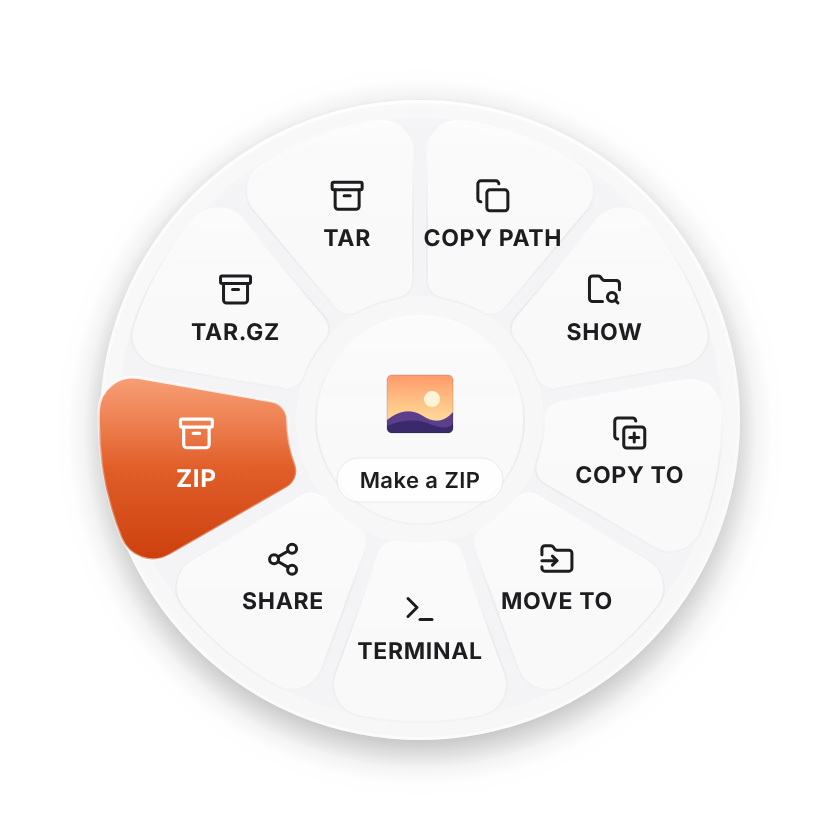

[README](../README.md) · [All docs](README.md)

# The Actions wheel

  <picture>
    <source media="(prefers-color-scheme: dark)" srcset="images/wheel-actions-dark.png">
    
  </picture>

Hold Control+Shift while dragging and a third wheel opens: what can be done with the dragged files themselves, whatever they are, folders too. None of it changes a file.

- **Copy path**: the full path on the clipboard, one per line for several files.
- **Show**: opens the folder with the files selected.
- **Copy to** and **Move to**: the system's folder picker opens (where the last one went), and the files and folders go into the folder chosen. Nothing there is replaced: a name that is taken gets a number ("photo 2.jpg"). Move renames on the same disk; onto another disk it copies, and removes the original only once the copy is complete. Links are copied as links, never followed.
- **Float**: the files go on a small card that floats above every window, next to the pointer, to drag out later into any app or folder: drag it by its icon or name to take the files out, or by the rest of the card to move the card. With Shift held while dragging them out, the wheel opens as for any drag. Finder decides move or copy as it does for its own drags; after a copy the card stays for the next place, and once the files have moved elsewhere it goes by itself. The × puts it away. Each Float makes its own card. Windows and Linux come later.
- **Terminal**: a terminal in the file's folder (in a dragged folder itself): the one chosen in Settings > General, or else Terminal on macOS, PowerShell on Windows, GNOME Terminal, Console, Ptyxis, Konsole or the system's default on Linux. The folder is handed over as the starting folder, never inside a command line.
- **AirDrop** (macOS): the AirDrop window for the files.
- **Share**: macOS: a menu at the pointer with what macOS offers for the files (Mail, Messages, AirDrop, Notes and apps that add their own), as in Finder's Share. Windows: the system's share sheet. Linux, which has no share sheet: email (xdg-email), Bluetooth (GNOME's or Blueman's send window) and each phone KDE Connect or GSConnect can reach, whichever the computer has; with more than one, a small window asks which.

- **ZIP**, **TAR.GZ**, **TAR**: an archive of everything dragged, files and folders, next to the first: "Photos.zip", "notes.txt.zip", or "Archive.zip" for several.
- **Unpack** (when every dragged file is a ZIP, TAR (plain, `.tar.gz`, `.tar.bz2`, `.tar.xz`, `.tar.zst`, `.tar.lzma` and their short forms), GZ, RAR, 7z, ISO disc image, CPIO, XAR, CAB, LHA/LZH or JAR): what the archive holds at the top goes next to it, when that is one folder or file, as Finder's Archive Utility does it; otherwise a new folder named after the archive. Nothing already there is replaced ("Photos 2").

Archives go through bsdtar (libarchive): built into macOS and into Windows 10 and later (tar.exe), `libarchive-tools` on Linux (the setup script installs it). It refuses names with ".." and strips a leading "/", so nothing lands outside the new folder; an archive that does try is refused as a whole and leaves nothing behind. Unpacking may write at most 1 GB plus twenty times the archive's size, so a "zip bomb" is stopped. Unpacking first goes into a hidden folder next to the archive, so a half-done unpack is never mistaken for a finished one. A password-protected archive is refused. Folders come out writable by the user even when the archive stored them read-only (disc images do), so they can be moved into place and tidied up; files keep their modes. Which of the formats open depends on the bsdtar: macOS's and Linux's `libarchive-tools` read them all; Windows' own tar.exe reads what its libarchive was built with, and says so when it can't. A plain .gz (one file, not a TAR) is unpacked by the app itself, within the same budget.

On a Mac, start the drag first and then press Control+Shift: Control held before the click turns it into a right-click. For moving files by hand there is the [shelf](shelf.md).
