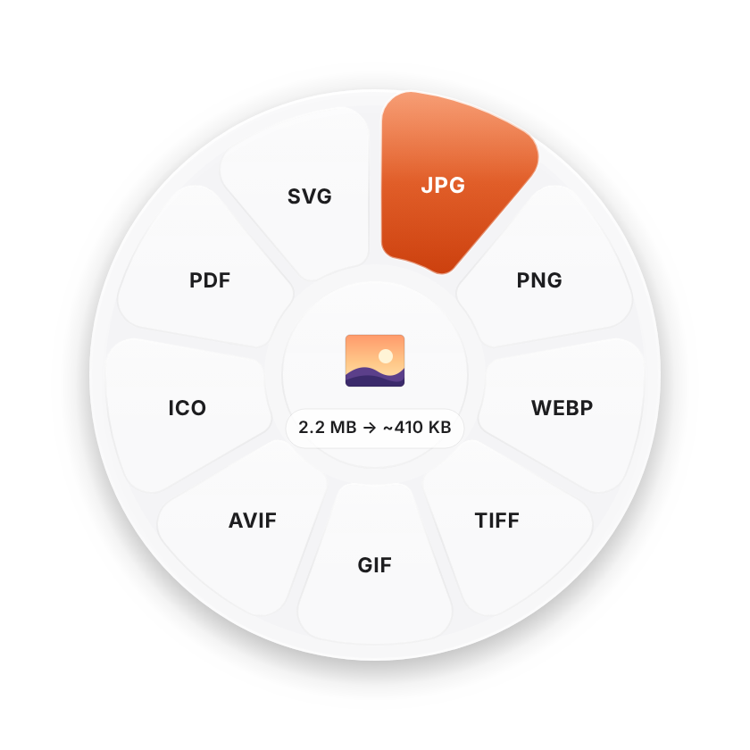

[README](../README.md) · [All docs](README.md)

# What converts to what

  <picture>
    <source media="(prefers-color-scheme: dark)" srcset="images/wheel-formats-dark.png">
    
  </picture>

| Files | Can become | Done by |
|---|---|---|
| Images: JPG, PNG, HEIC, WebP, TIFF, BMP, GIF, AVIF, SVG | JPG, PNG, HEIC, WebP, TIFF, GIF, AVIF, BMP, ICO, PDF, SVG | ImageMagick; SVG traced by [vtracer](https://github.com/visioncortex/vtracer), in the app |
| Other pictures (read only): PSD, PSB, TGA, PPM, PGM, PBM, PNM, PAM, PFM, APNG, MNG, QOI, DDS, PCX, CUR, XPM, XBM, WBMP, SGI, Sun Raster, MIFF, DICOM, Photo CD, Radiance HDR, FITS, GIMP (XCF), JPEG 2000, JPEG XL, OpenEXR, Apple icons (ICNS, macOS); ICO, JFIF, DIB in as their own | JPG, PNG, HEIC, WebP, TIFF, GIF, AVIF, ICO, PDF, SVG (BMP off until switched on, see [Settings](settings.md)) | ImageMagick; on macOS JPEG 2000, JPEG XL, OpenEXR and icons by macOS's own decoder (`sips`); elsewhere those need an ImageMagick built with their libraries |
| Camera RAW: DNG, CR2, CR3, NEF, NRW, ARW, ORF, RW2, RAF, PEF, SRW (read only) | JPG, PNG, HEIC, WebP, TIFF, AVIF, PDF | macOS's own RAW decoder (`sips`, as Preview); on Windows and Linux an ImageMagick built with LibRaw |
| Audio: MP3, WAV, M4A, AAC, FLAC, AIFF, OGG, Opus, WMA; also M4B, M4R, AIFC, AC3, E-AC3, DTS, AMR, AU, CAF, WebM sound (WEBA), MKA, MP2, VOC, WavPack, TTA, W64, APE, Musepack, TAK, DSF, Speex, DSS | MP3, M4A, WAV, FLAC, AIFF, OGG, Opus, WMA | ffmpeg |
| Video: MP4, MOV, M4V, MKV, WebM, AVI, WMV; also MPEG (MPG, MPE, M1V, M2V), DVD (VOB), camcorder (MTS, M2TS, M2T, MOD, TOD, DV), TS, 3GP, 3G2, OGV, FLV, F4V, MXF, DivX, ASF, QT, RealMedia (RM, RMVB), recorded TV (WTV, DVR-MS), raw H.264 and HEVC, security camera DAV, Bink, FLIC | MP4, MOV, WebM, MKV, AVI, WMV, GIF, MP3 (sound only) | ffmpeg |
| Documents: DOCX, DOC, ODT, RTF, Pages, Markdown, HTML, TXT, EPUB, RTFD, text clippings; also Word and ODF templates and macro files (DOCM, DOTX, DOTM, DOT, OTT), flat ODF (FODT), WordPerfect (WPD), Works (WPS), AbiWord (ABW, ZABW), StarWriter (SDW), Pocket Word (PSW), Windows Write (WRI); reStructuredText, LaTeX, Org, AsciiDoc, Typst, MediaWiki, DocBook, Jupyter (IPYNB), Textile, man pages, OPML, XHTML, FictionBook (FB2) | PDF, DOCX, ODT, HTML, Markdown, TXT, EPUB, Pages (macOS, made by Apple's Pages app) | LibreOffice for PDF and office formats, pandoc for the rest; Pages itself for Pages |
| Spreadsheets: XLSX, XLS, ODS, CSV, TSV, Numbers; also XLSM, XLTX, XLT, OTS, flat ODF (FODS), TAB | PDF, XLSX, ODS, CSV, TSV (first sheet) | LibreOffice |
| Presentations: PPTX, PPT, ODP, Keynote; also PPTM, POTX, POTM, shows (PPSX, PPS), POT, OTP, flat ODF (FODP) | PDF, PPTX, ODP, JPG, PNG (a picture of each slide) | LibreOffice; MuPDF for the pictures |
| PDF | JPG, PNG (a picture of each page), SVG (each page as vector shapes), TXT, DOCX, Markdown, EPUB (the text only), PPTX (a slide with a picture of each page), XLSX (each page's text in rows and columns, a sheet per page), Pages (the text, macOS) | MuPDF (`mutool`); pandoc for DOCX, Markdown, EPUB and PPTX; the app itself writes the XLSX |
| Comics: CBZ, CBT (read only) | PDF, JPG, PNG (a picture of each page) | MuPDF |
| Subtitles: SRT, VTT; also SubStation (ASS, SSA), SAMI (SMI), lyrics (LRC), MicroDVD and SubViewer (SUB), TV captions (SCC) | SRT, VTT, TXT (only the words) | ffmpeg; the app itself for TXT |
| Drawings: Visio (VSD, VSDX), CorelDraw (CDR), Publisher (PUB), Windows metafiles (EMF, WMF), ODF drawings (ODG, FODG), CGM, DXF | PDF, SVG (as shapes), PNG, JPG (a picture of each page) | LibreOffice Draw; MuPDF for the pictures |

The other pictures are read one picture each: a Photoshop file's merged picture (not its layers), a GIMP file's layers flattened into one, an icon's or cursor's largest size, a DirectDraw texture's full size, a DICOM or FITS file's first image. Each is recognised by its first bytes; Targa, WBMP, PCX, icons, cursors, XBM and Photo CD have no clear mark of their own, so for those the extension decides and the header must fit it. ImageMagick is always told which reader to use. On a Mac, JPEG 2000 (`.jp2`, `.j2k`, `.jpf`, `.jpx`), JPEG XL, OpenEXR and `.icns` icons are developed by macOS into a TIFF first, like camera RAW; on Windows and Linux ImageMagick reads them when it was built with their libraries (`magick -list format` lists JP2, JXL and EXR), and otherwise the app says which library is missing. Apple icons have no reader outside macOS, so `.icns` is offered on a Mac only.

A camera RAW photo is first developed into a 16-bit TIFF in the app's work folder, then converted from that like any picture. On a Mac that uses macOS's own RAW engine, so it needs nothing installed and reads the RAW files Preview reads. On Windows and Linux ImageMagick does it, but only when it was built with LibRaw: `magick -version` then lists `raw` under Delegates. Without LibRaw ImageMagick would hand the file to an outside program from its delegates list, which the app doesn't let it do; it says the RAW file can't be read instead. The file's start is checked against its RAW type first (TIFF inside for most, Olympus, Panasonic and Fujifilm their own, Canon's CR3 an ISO media file).

An SVG going in is drawn by the app itself with [resvg](https://github.com/linebender/resvg), in a process of its own, never by an outside SVG reader: at its own size, but at least 1024 and at most 8192 pixels on the longest side, with the system's fonts for its text. Pictures inside it are drawn only when they are part of the file (data: URLs); a link to any other file or to the web is left out. Then it converts like any picture.

An SVG going out is the picture traced into flat-coloured shapes, which scale to any size: best for logos, drawings, icons and screenshots; a photo becomes a poster-like picture. ImageMagick reads the picture and makes it at most 2000 pixels on its longer side (photos 1200, which trace in a few seconds), then vtracer (MIT or Apache-2.0, pure Rust, built into the app) traces it in a process of its own, so a slow one is stopped like any other tool. JPEG, HEIC and AVIF are taken as photos (coarser layers, small specks dropped); other pictures keep their flat colours. The picture quality in Settings > Quality picks how fine: Smaller Files drops more specks and merges more colours, Best Quality keeps more of both. Transparency is kept. An SVG can't be read back in: the wheel takes only plain pictures.

An icon (ICO) holds the picture at 256, 128, 64, 48, 32 and 16 pixels, fitted into a square with see-through edges rather than stretched. MKV is a fast copy of the streams when they fit, H.264 otherwise; AVI is MPEG-4 Part 2 (what Xvid makes) with MP3, and WMV is Windows Media 8 with WMA, for older players, at most 1920 pixels on the long side. Pages, Numbers and Keynote files go through LibreOffice, which reads them; a file saved as a package folder (older versions) is refused: save it as a single file. Subtitles should be UTF-8.

The wheel only shows formats that every dragged file can become. The new file lands next to the original. If the name is taken it becomes `name 2.ext`, `name 3.ext` and so on. Nothing is ever overwritten.

An RTFD (TextEdit's rich text with pictures, a folder) keeps its pictures on macOS, where textutil reads it; on Windows and Linux only its text and formatting come through. A text clipping (what Finder saves when text is dragged to a folder) gives its rich text, or else its plain text; a clipping of a picture or a link has no text to give. A PDF to XLSX puts each page's text back into rows and columns from where it sits on the page, one sheet per page; plain numbers ("1,234.56", "-3") become numbers, codes with leading zeros stay text. Scanned pages have no text to take. Pages comes from Apple's Pages app (free in the App Store): the document goes to Word first, then Pages opens that and saves it, so macOS asks once whether Pirouette may control Pages. Pages is always on the wheel on a Mac; without the Pages app, a drop on it opens the App Store on Pages and the notification says what to do, and Settings > General > Converters has **Get Pages…**. No app can install it from the App Store for you: the App Store asks for your Apple ID. Open Pages once after installing it, so its welcome window doesn't stand in the way.

A PDF with several pages becomes a folder of pictures next to it, `report (PNG)` holding `report 1.png`, `report 2.png` and so on, at 150 dpi; at most the first 100 pages, and the folder name says so when there were more. Text is taken from PDFs of up to 2000 pages. As text or a Word file, a PDF keeps its words and paragraphs but not its layout, tables or pictures. A scanned PDF has no text to take out. A PDF that needs a password to open is refused with a note to save a copy without it. For a Word file that keeps the layout, open the PDF in Word itself.

A notification says when a drop is done or why it failed, and how the size changed ("2.2 MB → 410 KB · photo (compressed).jpg"; not for folders, such as a split PDF). A click on it opens the folder with the new files selected (also later from the notification list: Notification Center on macOS, Action Center on Windows, until the app is quit; on Linux while the notification is on screen). Video also gets a "Converting…" notification first, because it can take a while. Meanwhile the menu shows how far a drop is, and **Stop Converting** ends it.

## Fonts in PDFs

LibreOffice running without a window only sees its own bundled fonts. The converter gives it a font list (`~/Library/Caches/io.github.oracola91.pirouette/fontconfig/fonts.conf`) with the macOS font folders, so documents keep their fonts.

Word's default font since 2023, Aptos, ships inside Word only, and its licence limits it to Microsoft products. So it is not handed to LibreOffice. Helvetica Neue, which comes with macOS, stands in for it. If Aptos is ever properly installed on the Mac, the real font is used instead. Calibri and Cambria need nothing, because LibreOffice ships look-alikes with the same spacing.
