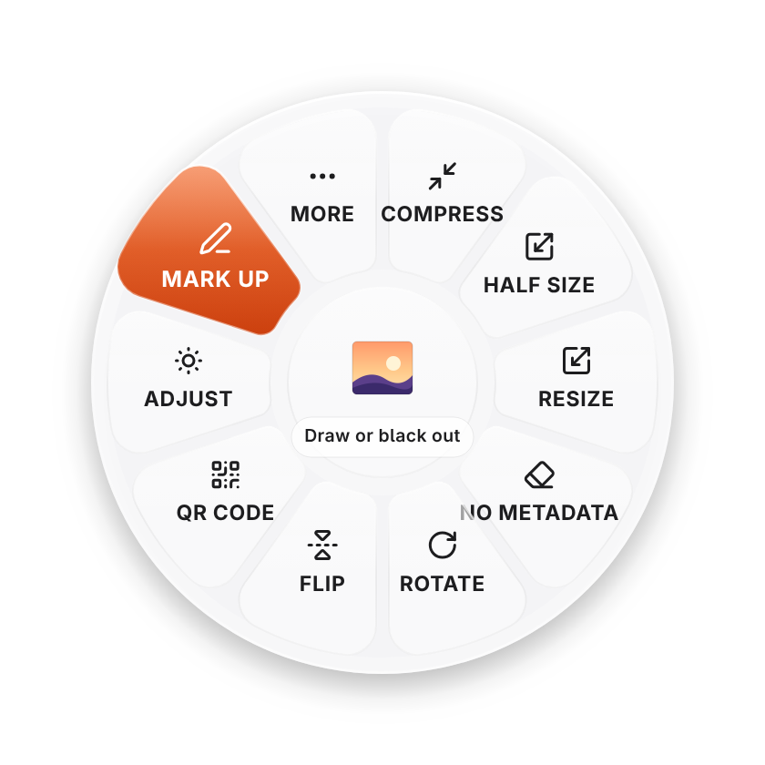

[README](../README.md) · [All docs](README.md)

# The Tools wheel

  <picture>
    <source media="(prefers-color-scheme: dark)" srcset="images/wheel-tools-dark.png">
    
  </picture>

Hold Option as well as Shift while dragging (Alt+Shift on Windows and on Linux with X11) and a second wheel opens: what can be done to the file while it keeps its format. The result goes next to the original, named after the tool ("photo (half size).jpg"), and never replaces it. For pictures (JPEG, PNG, HEIC, WebP, AVIF and TIFF; BMP gets Half Size and Rotate only; animated GIFs none):

- **Compress**: JPEG at quality 70; WebP and AVIF at 55, HEIC at 45 (its numbers run higher); PNG down to 256 colours (dithered); TIFF with lossless ZIP. A result that isn't smaller is not saved, and the notification says so.
- **Half size**: half the width and height.
- **Resize** (one picture at a time): opens a small window with the picture's size, a box for the longest side in pixels (16 to 16000, larger works too) and common sizes (3840 down to 640); the other side follows in proportion: "photo (1920 px).jpg".
- **Remove metadata**: takes out EXIF (camera, date, location), XMP, IPTC and comments, and keeps the colour profile. The picture is turned upright first, so it looks the same without the EXIF turn.
- **Rotate**: a quarter turn clockwise.
- **Flip**: mirrored left to right: "photo (flipped).jpg".
- **QR code** (GIFs too, their first frame): reads every QR code in the picture. The text is saved next to it ("photo (QR code).txt"), copied to the clipboard and shown in the notification; a link in it is never opened. Read by [rqrr](https://github.com/WanzenBug/rqrr), in the app itself.
- **Adjust** (one picture at a time): opens a window with the picture and sliders for brightness, contrast and saturation (each 0 to 200%), shown on the picture as they move; Reset puts them back, Enter adjusts, Esc cancels. ImageMagick then does the same steps as the preview, in the same order: "photo (adjusted).jpg". The window only sends the three numbers back.
- **Mark up** (one picture at a time): opens a window with the picture to draw on: a pen, a see-through highlighter, shapes (arrow, line, box, circle, from one Shapes menu), words and numbered steps (click to drop 1, 2, 3 in coloured circles). **Select** picks a mark already drawn: drag it or nudge it with the arrow keys (Shift for bigger steps), change its colour or size, Delete removes it, and a double-click on words retypes them (so does clicking them with Text). Undo (Cmd/Ctrl+Z) steps back through every change. Words are typed straight onto the picture: click where they go, type, Enter (Esc drops them). A Size box works like Word's: pick from the list (8 to 72 for words, 1 to 20 for lines) or type a number, in points as the picture looks in the window, so what you see is what is saved. Six quick colours (red, yellow, blue, green, black, white), and More opens a palette of 60 others or takes any colour code like #ff8800; the last three picked stay next to the quick ones. **Black out** covers a part with solid black. The window only sends the shapes back; the app checks each one and ImageMagick draws them, the blacked-out parts last so nothing lands on top of them. A picture with a blacked-out part also loses its metadata, keeping only the colour profile: the small preview a camera keeps in the EXIF would otherwise still show what was covered. Words are drawn in a font the system has (Arial or Helvetica on macOS, Arial on Windows, DejaVu, Liberation or Noto Sans on Linux). The result is "photo (marked up).jpg".
- **Crop** (one picture at a time): opens a window with the picture and a box to drag by its middle, corners and sides. Free, the picture's own shape, square, 4:3, 3:2 or 16:9; turn it left or right; Enter crops, Esc cancels. The result is "photo (cropped).jpg". The window only sends the box back: which file it applies to stays in the app. A video can be cropped the same way (one at a time), on a typical frame of it; the video is turned and cropped, then encoded again in its own format at the menu's quality: "clip (cropped).mp4".

The other tools keep the metadata. Every tool saves the picture again: JPEG at its own quality, HEIC, WebP and AVIF at 80.

**One PDF** (two pictures or more dropped together): a PDF with one picture per page, in the order dropped, next to the first: "IMG_1234 (one PDF).pdf". Each page is as long as an A4 page on its long side (a picture under 842 pixels keeps a smaller page); photos go in as JPEG, screenshots and other pictures as PNG. Up to 200 pictures. Needs ImageMagick and MuPDF.

**Collage** (two pictures or more dropped together): one picture with all of them in a grid on white, in the order dropped, each fitted into a square of its own, next to the first: "IMG_1234 (collage).jpg". Two make one row, five make a row of three and a row of two (a short last row sits in the middle). Up to 36 pictures. Needs ImageMagick.

For PDFs (with MuPDF):

- **Merge** (two PDFs or more dropped together): one PDF with all their pages, in the order dropped, next to the first: "report (merged).pdf". Up to 2000 pages in all. A PDF that MuPDF can't read stops the merge with its name, instead of being left out quietly.
- **Split**: one PDF per page in a new folder, "report (pages)/report 01.pdf"; the first 100 pages, and the folder name says so when there were more.
- **Reorder** (one PDF of 2 to 100 pages at a time): opens a window with a small picture of every page, to drag into a new order. A page picked with a click or the arrow keys also moves with Shift and the arrow keys; Reverse turns the whole order round, Reset puts it back. Enter reorders, Esc cancels. Bookmarks follow their pages, and the title and author stay: "report (reordered).pdf". The window only sends the new order back.
- **To %** (two or more files: JPEG, HEIC, WebP, AVIF pictures, the videos and sounds To a Size takes, PDFs): one window for all of them, a share from 5 to 95% (75, 50, 25, 10 or typed); each file is compressed as To a Size would, to at most that share of its own size: "photo (50%).jpg". For one file, To a Size has Half and Quarter.
- **Password** (one PDF at a time): opens a small window for a password, typed twice (at most 64 characters, no comma: MuPDF takes its save options as one comma-separated list). The copy is encrypted with AES-256 and opens only with it; the same password allows changes. MuPDF's script reads the password from a file in the app's private work folder, removed right after, so it is never on a command line, where other users of the computer could see it: "report (locked).pdf". Keep the password: without it the copy can't be opened. The original stays as it was. Ubuntu 22.04's MuPDF 1.19 is too old for it: there the notification says a newer MuPDF is needed.
- **PDF/A**: a copy in PDF/A-2b, the form of PDF meant for archiving: fonts embedded, colours in sRGB with the sRGB profile as its output intent, and what PDF/A can't hold (scripts, outside links) left out: "report (PDF-A).pdf". The title and other details stay. Made with Ghostscript (`brew install ghostscript`, `sudo apt install ghostscript`); winget has no Ghostscript, so on Windows the message points to ghostscript.com's download page. A PDF locked with a password can't be read.
- **Smaller**: pictures above 225 dpi scaled down to 150 dpi and photos saved again as JPEG at quality 60, each only where that is smaller; fonts and streams compressed, unused and duplicate parts dropped. Text stays text. Older MuPDF without the picture options (Ubuntu's own packages) only tidies the file, which seldom makes it much smaller. Not saved if it isn't smaller. If MuPDF crashes on a PDF (seen on Windows with a few PDFs), Smaller tries again with less tidying, then with only compressing the streams; if MuPDF still crashes, the notification says so and the PDF is left as it was.

For video and audio (with ffmpeg):

- **Compress** (MP4, MOV, M4V, MKV, WebM): at most 1920 pixels on the long side; H.264 at CRF 28 with AAC 128k, or for WebM VP9 at CRF 38 with Opus 96k. Not saved if it isn't smaller.
- **Remove metadata** (video and audio): a copy of the picture and sound without the file's and the streams' metadata (where and when it was recorded, the device, tags, cover art, chapters) or the data tracks phones keep it in. Nothing is encoded again, so it is quick.
- **First frame** (video): the first frame as a JPEG: "clip (first frame).jpg".
- **Snapshot** (video, one file at a time): opens a window with the video's frame and a slider along it (arrow keys step a frame, with Shift a second); Save Picture writes that moment as a JPEG at the video's own size: "clip (frame at 1m05s).jpg".
- **Mute** (video): the picture copied as it is, without any sound track; quick, nothing is encoded again: "clip (no sound).mp4".
- **Flip** (video): mirrored left to right, encoded again in the file's own format at the menu's quality, with the first sound.
- **Resize** (video, one file at a time): the same window as for pictures, with 4K, 1440p, 1080p, 720p, 480p and 360p (as the longest side: 3840 down to 640) or any longest side from 16 to 7680; the other side follows, kept even; encoded again like Flip: "clip (1280 px).mp4".
- **Loudness** (audio): evened out to -16 LUFS with peaks at most -1.5 dB (ffmpeg's loudnorm), at the file's own sample rate, tags kept.
- **Mono** (audio): both channels mixed into one.
- **Compress** (MP3, M4A, AAC, Ogg, Opus, WMA, FLAC): the same format at a lower bit rate (MP3, M4A and WMA 96k, Ogg and Opus 64k), tags kept; FLAC stays lossless at its strongest packing. Not saved if it isn't smaller. WAV and AIFF have nothing to compress with.
- **To a size** (JPEG, HEIC, WebP, AVIF pictures; MP4, MOV, M4V, MKV, WebM videos; MP3, M4A, AAC, Ogg, Opus, WMA sound; PDFs; one file at a time): a small window asks for a size ("2 MB", or Half, Quarter, 25 MB, 10 MB, ...) and the result comes in at that or under: "photo (under 2 MB).jpg". Pictures get the highest quality that fits (found by halving 25 to 92), and are made smaller only if even the lowest is too big. Video gets the bit rate the size allows over its length, in two passes, with a smaller picture as the rate drops (1920, 1280, 854); sound gets the bit rate that fits. A PDF is tidied like Smaller and its pictures are saved again, step by step from 150 dpi at JPEG quality 70 down to 50 dpi at 25, until it fits; text stays text, so a PDF of text alone may not get much smaller (needs a MuPDF with the picture options, not Ubuntu 22.04's). The window says how small a long file can go.
- **Join** (two or more sound files, or two or more videos): one after another, in the order dropped, as one file in the first one's format: "clip (joined).mp4". Every part is encoded again, so different formats, sizes and rates fit: videos take the first one's size (the others fitted in, with bars) and frame rate, and a video without sound gets silence for its length. Up to 50 files.
- **Black out** (video, one file at a time): opens the Mark up window on a typical frame of the video, with only Select and Black out: draw a box over each part to hide (a face, a number plate, a screen), move or resize it with Select, Undo steps back. Each box is filled solid black on every frame of the video, at the same place (the frame is shown upright, as the video plays). Boxes grow outward to even pixels, since video keeps colour at half the resolution. The result has only the picture and the first sound: no cover picture, subtitles, chapters or other tracks, and no metadata (where it was recorded, the device). Encoded again in its own format at the menu's quality: "clip (blacked out).mp4". A part that moves across the picture needs a box big enough for all of it.
- **Trim** (audio and video, one file at a time): opens a window with the sound's loudness along its length, a video's frames above it, and the part to keep between two ends to drag (or times to type, "1:23.4"). Play plays that part first (files up to 20 minutes). Enter trims, Esc cancels, Space plays. The cut is exact, not at the nearest keyframe: the part is encoded again in the file's own format at the menu's quality. The result is "clip (trimmed).mp4".
- **Bleep** (audio and video, one file at a time): opens the Trim window to pick the part to bleep out (a word, a name), with Play to find it. That part of the sound becomes a 1 kHz tone; the rest stays as it was, and a video's picture is copied as it is, not encoded again. The result is "clip (bleeped).mp4".
- **Speed** (audio and video, one file at a time): opens a small window with the speeds 0.25x, 0.5x, 0.75x, 1.25x, 1.5x, 2x and 4x (arrow keys move between them) and how long the file will play at the one picked. The sound keeps its pitch. Encoded again in the file's own format at the menu's quality: "clip (2x speed).mp4".
- **Split** (audio and video, one file at a time): opens a small window to pick how many equal parts (2 to 10), or how long each part is (10 seconds to 30 minutes). Each part is cut exactly, like Trim, and they go in a new folder next to the file: "clip (parts)/clip 1.mp4", "clip 2.mp4", ... Up to 50 parts of a second or more; a few moments left at the end go onto the last part.
- **Info** (pictures, sound, video and PDFs, one file at a time): opens a window with what the file says about itself. A picture: its size, when it was taken, the camera and lens, and where it was taken (or "none in the file"). A video: its tags, when and on what it was recorded, and where. A PDF: its pages, title, author, what made it and its dates. A sound file's title, artist, album, year, genre and comment, and a PDF's title, author, subject and keywords, can be changed: they go into a copy, "song (new info).mp3", with everything else as it was (ffmpeg copies the sound, nothing is encoded again). A picture's date taken and location, and a video's recording date and location, can be changed too (JPEG, PNG, HEIC, WebP, TIFF, AVIF; MP4, MOV, M4V), with [ExifTool](https://exiftool.org), one more converter installed on demand like the others: the date as 2024-05-01 12:34:56, the place as latitude, longitude (51.50343, -0.12800), and an emptied Location box takes the place out, everything else in the file staying (the Tools wheel's Clean takes out all of it). ExifTool writes only the new copy (`-o`, no backup file, no config file, no shell line; 12.24 or newer). The app then reads the copy back, and a copy that doesn't say what was asked is deleted and the job fails. Videos get the date in QuickTime's own tag (from local time to UTC) and in Apple's keys, and the place in Apple's keys and the common user data, so Photos and other players find it. Other picture and video formats (BMP, GIF, MKV, WebM, AVI, WMV) are only shown. Older MuPDF (Ubuntu 22.04's) only shows a PDF's details too.

Loudness and Mono save the audio again in its own format (MP3 VBR quality 2, AAC 256k, Opus 160k; WAV and AIFF as 16-bit). On Wayland, Shift+drag (with Option or Control for these wheels) needs GNOME and its helper extension (see [On Windows and Linux](windows-and-linux.md)); the keyboard shortcut opens the Formats wheel, and while it is open a tap of Alt or Control switches it to the Tools or Actions wheel (by the Keys in Settings) and a second tap goes back; Tab goes round all three. `pirouette --show tools` and `--show actions` open those wheels straight away, for shortcuts of their own.
